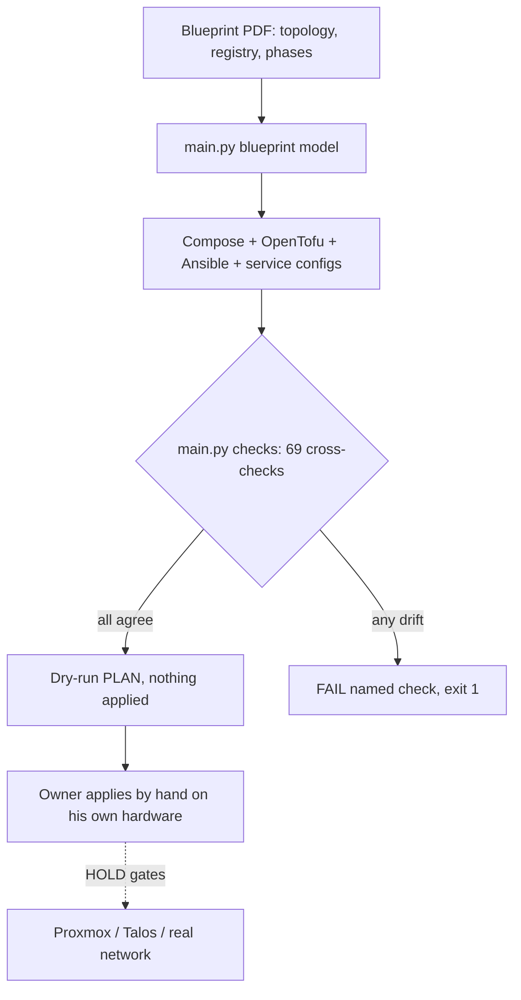
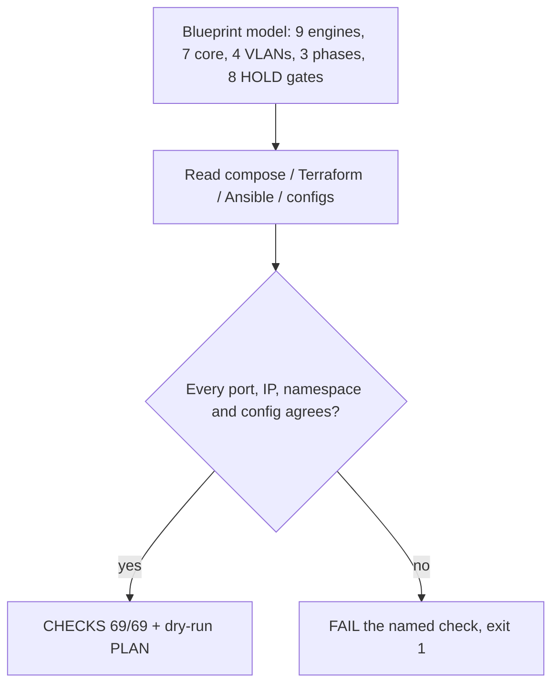
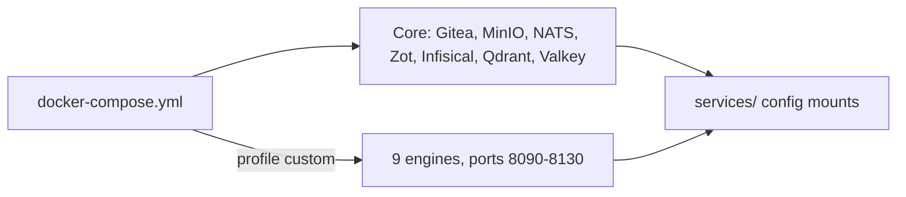
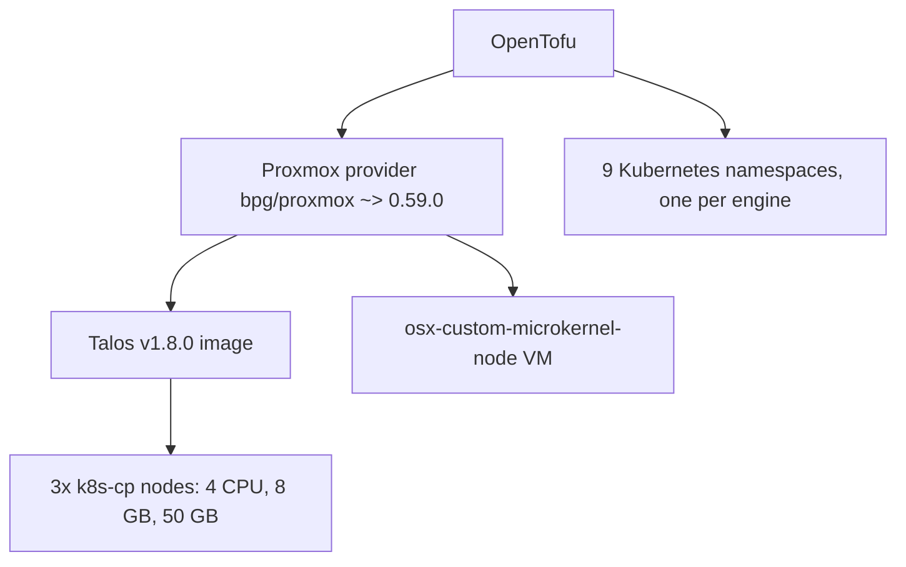
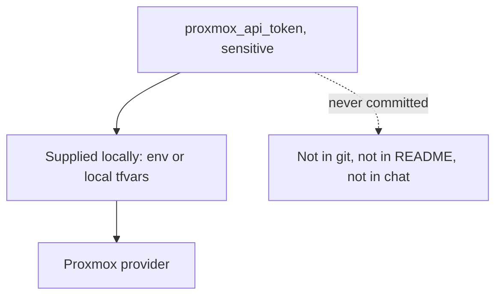
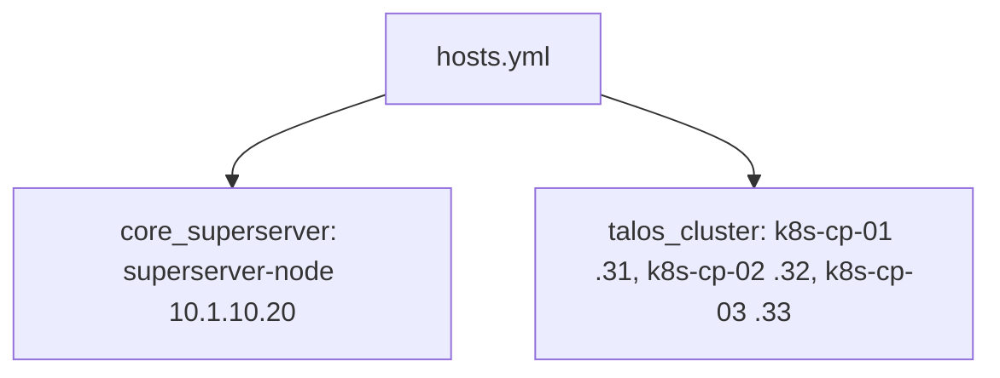
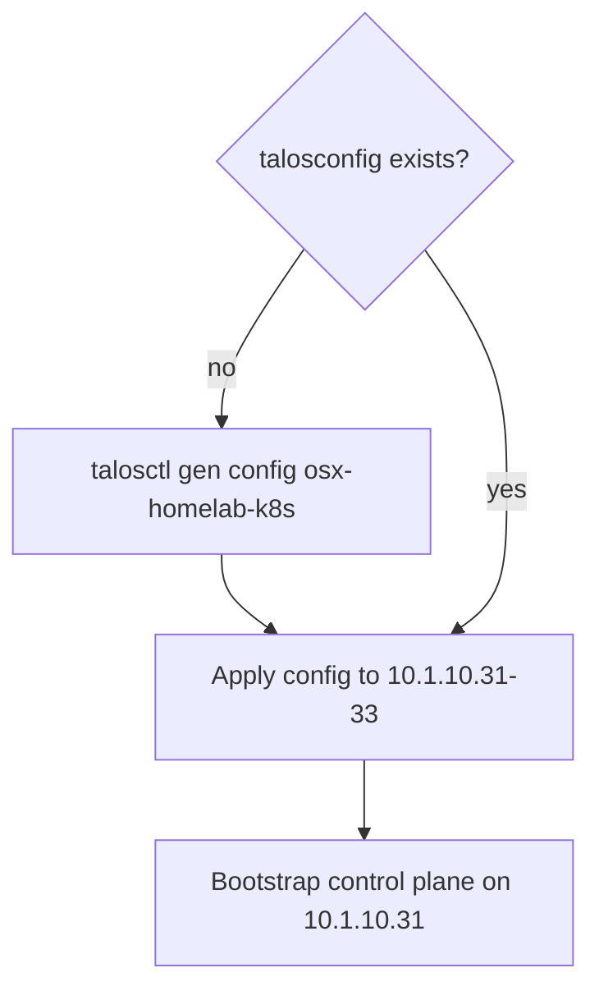
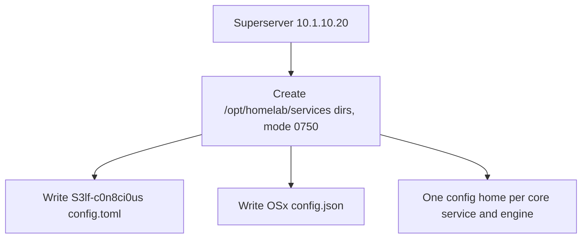
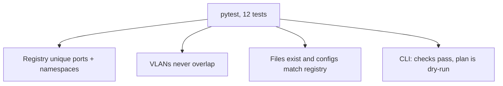
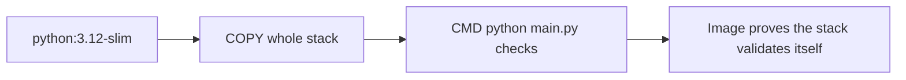

# OSx-HomeLab 🏠🖥️

**Master deployment stack built from the OSx-HomeLab blueprint PDF.** One folder that describes a whole home lab: a 10G network, an immutable 3-node Kubernetes cluster, a custom OSx microkernel test node, self-hosted dev tools, and Darion's 9 autonomous engines wired in as one mesh — all as code, all validated by one pure-Python checker, and **nothing applied to real hardware unless the owner does it by hand.**


> 🏷️ **Badge honesty note:** every shields.io badge above was verified live (HTTP 200) before this README shipped. The CI / Docker Publish badges are static **Pending Paste** badges on purpose: the real GitHub Actions `badge.svg` URLs for this repo return 404 until the two workflow files below are pasted into `.github/workflows/` (**plural**) and run once — then swap these two static badges for the live ones. The Docker Hub badge points at `credkellar/osx-homelab`, which does not exist yet (checked, 404) and is created by the first Docker Publish run.

## ⚙️ Updated workflows

Two GitHub Actions workflows ship as paste-ready files with this project (the GitHub App cannot write workflow files, so they are pasted into `.github/workflows/` — **plural** — by the repo owner). Paste rule for both: create the file under `.github/workflows/`, paste the whole block, and **press Enter once at the very end** so the last line ends clean.

### 🧪 CI — `ci.yml`

- **Triggers:** every push and every pull request, with per-branch concurrency cancel
- **Runs on:** `ubuntu-latest`, 15-minute timeout
- **Steps:** `actions/checkout@v4` → `actions/setup-python@v5` (Python 3.12) → `pip install pytest` → `python main.py checks` → `python -m pytest tests/ -q`
- **Why this CI:** the design contract of this repo is its structure — if a port, IP, namespace or config drifts from the blueprint registry, CI goes red before anything else matters

### 🐳 Docker Publish — `docker-publish.yml`

- **Triggers:** pushes to `main`, version tags (`v*`), and manual `workflow_dispatch`; no cancel-in-progress, so a publish never gets cut in half
- **Steps:** `actions/checkout@v4` → `docker/setup-buildx-action@v3` → `docker/login-action@v3` → `docker/build-push-action@v6`
- **Tags it pushes (verified against this repo's name before delivery):** `credkellar/osx-homelab:latest` + `credkellar/osx-homelab:sha-<commit>`
- **Secrets it needs (set per-repo, on THIS repo):** `DOCKERHUB_USERNAME`, `DOCKERHUB_TOKEN`
- **Order matters:** add the secrets first, paste `docker-publish.yml` **last** — pasting it to `main` triggers the first publish

## 🧰 Tech Stack Badges & Full Architecture Tech Stack

The badge wall at the top is this stack at a glance. In full, by category:

### 💻 Core Programming Languages & Core Systems

- 🐍 **Python 3.12, stdlib only** — `main.py`, the validator/planner (zero dependencies)
- ⚙️ **HCL** — OpenTofu/Terraform provisioning (`terraform/`)
- 📜 **YAML** — Docker Compose + Ansible inventory and playbooks
- 🧾 **JSON / TOML** — per-engine service configs (`services/*/config.json`; S3lf-c0n8ci0us also `config.toml`, as in the blueprint)

### ⛓️ Web3 & Infrastructure

- 🏦 Engines in the mesh include Crypto-Recovery-Forensics (UTXO/EVM tracing) and Quantum-TraderX — **simulation-first; live trading is a HOLD gate in this stack**
- 🪙 The OSx engine itself carries the Monad HFT tuning heritage from `credkellar/OSx` — as a tuning profile, not an on-chain client in this repo

### ⚙️ Platform Support & Hardware Architecture

- 🖥️ Unraid superserver (Proxmox host, `10.1.10.20`) · 3× Mini-PC Talos nodes (`10.1.10.31–33`) · dual-24GB GPU AI workstation (Phase 3) · PiKVM/JetKVM out-of-band management · UPS with NUT telemetry · smart metered PDU

### ⚡ Low-Level Infrastructure & Performance

- 🌐 10G SFP+ DAC backbone, UniFi Cloud Gateway Fiber (UCG-Fiber), dual-WAN (AT&T Fiber + Gateway Fiber) + LTE/5G failover
- 🐝 Cilium eBPF CNI + Tetragon syscall telemetry, Longhorn replicated NVMe, kernel-bypass networking on the OSx test node, SPAN-port Suricata/Zeek inspection (Phase 3)

### 🛠️ DevOps & Build Tools

- 🐳 Docker Compose · 🦊 Gitea + Woodpecker CI · 📦 Zot OCI registry · 🔄 ArgoCD GitOps · ♻️ Renovate · 🗄️ MinIO (S3) · 🔐 Infisical secrets · 🪪 Authentik SSO / hardware MFA · 📨 NATS JetStream · ⚡ Valkey · 🔎 Qdrant

### ☁️ Cloud Providers

- 🏠 **None required.** The whole point is self-hosted. Cloud is optional backup only — the stack runs on the owner's hardware, under the owner's keys.

## 📦 What is this about?

The blueprint (a 10-page PDF, *OSx-HomeLab — Master Infrastructure & Orchestration Blueprint*) designed the lab on paper: topology, VLANs, phases, a registry of 9 engines with ports and namespaces, an `/opt/homelab/` folder tree, and starter OpenTofu and Ansible code. **This repo is that paper turned into real, checked files.** The validator (`main.py`) proves the files all agree with each other — every engine port in the registry is in the Compose file, every Talos node IP is in the Ansible inventory, every service config matches the registry — before anyone runs anything on hardware.

> ⚠️ **Honest status:** this is a *blueprint stack*, not a running lab. The 10.1.x.x network in these files is the blueprint's **target design** — it is not Darion's current home LAN. The validator is dry-run only: it never touches a network, Docker, Proxmox, or a cluster. Applying Terraform/Ansible to real machines is a HOLD gate (see below) and is the owner's manual step on his own hardware.

## 🔧 What this does?

1. 📋 Holds the **single source of truth** for the lab: 9 engines, 7 core services, 4 VLANs, 3 Talos nodes, 3 phases, 8 HOLD gates.
2. ✅ **Validates the whole stack against itself** — 69 named checks across the registry, Compose, Terraform, Ansible, and every service config.
3. 🗺️ Prints a **dry-run plan** (phases, nodes, services, gates) that applies nothing.
4. 🐳 Describes the **runnable core stack** in Compose, with the 9 engines behind the `custom` profile.
5. 🏗️ **Provisions (on paper, ready to apply by hand)** the Talos cluster, the OSx microkernel test VM, and one Kubernetes namespace per engine.
6. 🎛️ **Bootstraps and deploys via Ansible** — cluster first, then every service directory and config, exactly as blueprint section 8 specifies.

## ⚙️ How this works?



Step by step: the blueprint model inside `main.py` is loaded first. The validator then reads every describing file in the repo and compares it to the model — registry ports against Compose, Talos IPs against the Ansible inventory, namespace names against Terraform, every `config.json` against its registry row. If everything agrees, `plan` prints the three phases in order. Nothing in this repo can reach a real machine: the apply step belongs to the owner, on his hardware, behind the HOLD gates.

## 📊 Mermaid flowchart diagram per script

### 🐍 `main.py`



### 🐳 `docker-compose.yml`



### 🏗️ `terraform/main.tf`



### 🔐 `terraform/variables.tf`



### 🎛️ `ansible/inventory/hosts.yml`



### ☸️ `ansible/playbooks/deploy-talos.yml`



### 🚀 `ansible/playbooks/deploy-core-stack.yml`



### 🧪 `tests/test_homelab.py`



### 📦 `Dockerfile`



## 😎 Why is this cool?

The short version: a PDF became a self-checking stack. The 10 reasons are next.

## 🏆 10 reasons why this is cool

1. 📄➡️💻 A paper blueprint became real files that check themselves.
2. 🎯 One source of truth — registry, Compose, Terraform, Ansible and configs must all agree, or checks go red.
3. 🆓 Zero Python dependencies — the validator runs anywhere Python 3.12 does.
4. 🧱 Immutable Kubernetes — Talos has no SSH surface to attack.
5. 🚀 A 10G core kills the old 1 Gbps routing chokepoint (Phase 2).
6. 🛡️ The dangerous lab gets its own VLAN 99, blocked from the house LAN.
7. 🔐 Zero-plaintext secrets by design — Infisical plus a `.env.example` with placeholders only.
8. 🤖 All 9 of Darion's engines get a port, a namespace, and a config home in one mesh.
9. 🧪 Chaos and supply-chain checks are in the plan (Chaos Mesh, Trivy, Cosign) before anything goes live.
10. ⏸️ HOLD gates mean the plan can be shared, read, and tested without ever touching real hardware.

## 🧩 What problems this solves?

Home labs rot: one host becomes a single point of failure, configs drift from the diagram, secrets leak into git, and the lab network endangers the house network. This stack attacks each of those directly — the 10 solutions are next.

## 💡 10 solutions

1. **Problem:** One host dies and everything dies. **Solution:** Phase 1 resilience — secondary DNS VIP, UPS/NUT telemetry, replicated-storage plan.
2. **Problem:** A 1 Gbps router bottlenecks the lab. **Solution:** Phase 2 10G SFP+ core + UCG-Fiber with dual-WAN failover.
3. **Problem:** Kubernetes nodes drift and get hand-edited. **Solution:** Talos Linux — immutable, API-driven, config only from Ansible/OpenTofu.
4. **Problem:** Secrets end up in git. **Solution:** `.env.example` placeholders only; real values live in Infisical / a local `.env` that is git-ignored.
5. **Problem:** Nine engines, nine different setups. **Solution:** One registry (port + namespace + repo) that every other file is checked against.
6. **Problem:** Lab experiments endanger the house network. **Solution:** VLAN 99 isolation, with unsolicited RFC1918 traffic into VLAN 10 blocked.
7. **Problem:** Nobody knows if the files still match the blueprint. **Solution:** `python main.py checks` — 69 named checks, exit 1 on any mismatch.
8. **Problem:** A bad plan gets applied for real. **Solution:** The validator is dry-run only; applying anything is a HOLD gate for the owner, by hand.
9. **Problem:** Vendor lock-in to a cloud. **Solution:** Everything self-hosted: Gitea, Zot, MinIO, NATS, Valkey, Qdrant.
10. **Problem:** Observability bolted on later. **Solution:** Phase 3 bakes in OpenTelemetry, Tempo, Pyroscope, Loki, Alertmanager + Ntfy from the design stage.

## 🚀 How to install this?

### Step-by-step

1. 📥 Clone this repo (or copy the folder) onto your own machine:
   ```bash
   git clone https://github.com/kimanicollier44-cmyk/OSx-HomeLab.git
   cd OSx-HomeLab
   ```
2. ✅ Run the validator first — no install needed beyond Python 3.12:
   ```bash
   python main.py checks     # expect: CHECKS 69/69
   python main.py plan       # dry-run plan, applies nothing
   python main.py registry   # the 9 engines, ports, namespaces
   python main.py vlans      # the 4 VLANs
   python -m pytest tests/ -q   # expect: 12 passed
   ```
3. 🐳 (Optional) Run the validator as a container:
   ```bash
   docker build -t credkellar/osx-homelab .
   docker run --rm credkellar/osx-homelab
   ```
4. 🔐 Copy `.env.example` to `.env` and fill it **locally** (never commit it).
5. 👀 (Optional, on your own hardware) Preview the core stack: `docker compose config` — add `--profile custom` to include the 9 engines.
6. 🏗️ (Owner-only, manual, HOLD-gated) On your Proxmox host: `cd terraform && tofu plan` — review, then apply only if you mean it.
7. 🎛️ (Owner-only, manual, HOLD-gated) Bootstrap: `ansible-playbook ansible/playbooks/deploy-talos.yml`, then `ansible-playbook ansible/playbooks/deploy-core-stack.yml`.

## 📋 Requirements

- 🐍 Python 3.12+ (validator + tests; `pytest` for the test suite only — the validator itself is stdlib-only)
- 🖥️ To validate: any machine that runs Python. Nothing else.
- 🐳 For real deployment (owner's hardware only, not needed to validate): Docker + Compose, OpenTofu >= 1.6, Ansible, `talosctl`, Proxmox, and the Phase 1–3 hardware from the blueprint (superserver, 3 Mini-PC nodes, UCG-Fiber, 10G switch, GPU workstation for Phase 3)

## 🧒 Explain in 5th grade English

Imagine your computers are a small city. This project is the city's map and rule book. It says which streets (network VLANs) go where, which buildings (services) sit on which street, and what number is on each door (ports). One checker walks the whole city and makes sure the map and the real buildings match. Nobody is allowed to actually build or knock down a building until the city's owner says so — that is the HOLD gate. The city has a fast main road (10G), a strong town hall that never changes unless the whole town votes (immutable Kubernetes), and a special street where scientists can test wild ideas safely without bothering anyone's house (VLAN 99).

## 🚦 HOLD gates (8)

`apply_terraform_to_real_proxmox` · `run_ansible_on_real_hosts` · `bootstrap_real_talos_cluster` · `connect_real_dual_wan` · `store_real_secrets_in_infisical` · `push_images_to_real_registry` · `enable_live_trading_in_quantum_traderx` · `expose_any_service_to_internet` — all held. This repo validates and plans; it never applies.

## 🌲 Full project tree

```
📁 OSx-HomeLab/
├── 🖼️ cover.png                  # cover image (repo root, uploaded by the owner)
├── 🐍 main.py                    # validator + planner (stdlib only)
├── 🧪 tests/test_homelab.py      # pytest suite (12 tests)
├── 🐳 docker-compose.yml         # core services + 9 engines (custom profile)
├── 🔐 .env.example               # placeholders only, never real secrets
├── 📦 Dockerfile                 # runs the validator
├── 🚫 .gitignore
├── 📜 LICENSE
├── 🏗️ terraform/
│   ├── main.tf                   # Proxmox: Talos image, 3 CP nodes, OSx VM, 9 namespaces
│   └── variables.tf              # proxmox_api_token (sensitive, supplied locally)
├── 🎛️ ansible/
│   ├── inventory/hosts.yml       # superserver .20, talos .31-.33
│   └── playbooks/
│       ├── deploy-talos.yml
│       └── deploy-core-stack.yml
├── 🩹 patches/.gitkeep           # talosconfig lands here (git-ignored when real)
└── 📁 services/
    ├── 🦊 gitea/ 🗄️ minio/ 📨 nats/ 📦 zot/ 🔐 infisical/ 🔎 qdrant/ ⚡ valkey/
    └── 🖥️ osx/ 🧠 s3lf-c0n8ci0us/ 🏦 agents-xcrops/ 📈 quantum-traderx/
        🔬 autonomous-tech-infrastructure/ 🌿 advanced-medical-institution/
        ⛓️ crypto-recovery-forensics/ 🎬 creator-pipeline/
        🥷 sysadmin-footprint-mask/   # config.json each
```

*Built 2026-11-13 from Darion Kellar's OSx-HomeLab blueprint PDF. OSx itself: [credkellar/OSx](https://github.com/credkellar/OSx). Cover: `cover.png` at the repo root — the PNG is binary, so it was uploaded to the repo by the owner; the README header above points at it.*
